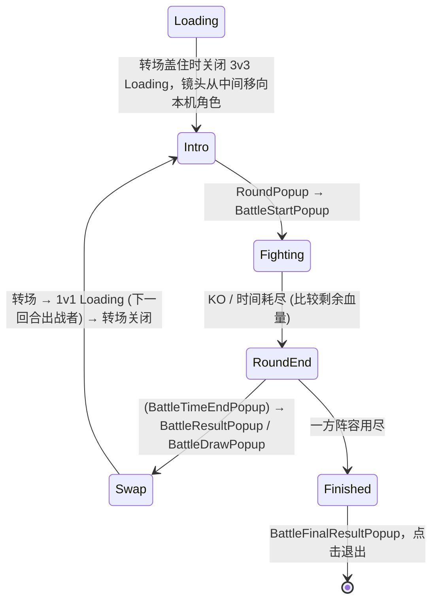

# KiHan UI 框架 (UI Framework)

> 适用于全部 UGUI 界面。新建界面的步骤与检查清单见 [UI_GUIDE.md](UI_GUIDE.md)，编码细则 (按钮回弹、布局、性能) 见 [.agents/ui.md](../.agents/ui.md)。

## 1. 总览

```
GameFlow (流程：登录 → 大厅 → 战斗 → 大厅 / 登出)
   │ Open / Close / CloseLayer
   ▼
UIManager ── AssetManager (按地址加载面板预制体)
   │
   ▼
UIRoot (代码构建，常驻)
   ├─ Layer_Scene    sortingOrder 0
   ├─ Layer_Hud      100   战斗 HUD
   ├─ Layer_Normal   200   全屏界面 (返回栈)
   ├─ Layer_Popup    300   弹窗 (模态遮罩)
   ├─ Layer_Toast    400   飘字提示
   ├─ Layer_Loading  500   切换 Loading
   └─ Layer_System   600
```

- 每层一个 Canvas (Screen Space Overlay)，`CanvasScaler` 按屏幕尺寸缩放：参考分辨率 **2640×1200** (Device Simulator 华为 P40 Pro 横屏，现有界面均按它摆放)，按高度适配 (`match = 1`)。P40 Pro 上缩放 1，其他设备按屏幕高度等比缩放。
- 面板预制体**不带 Canvas**，根节点是铺满父节点的 `RectTransform`，打开时挂到对应层下。需要单独重建 (频繁变化) 的局部可以加子 Canvas。
- 每个面板 / 弹窗是独立预制体，用到时才加载：`Assets/AssetPackages/Res/UI/Panels/<模块>/<名字>.prefab` (地址 `UI/Panels/<模块>/<名字>`)；面板逻辑是 Lua (`Assets/Lua/ui/<模块小写>/<名字>.lua`)，部件 (`UIView`) 是 C# (`Scripts/View/UI/<模块>/`)。

### 目录

```
Assets/Scripts/View/UI/
├─ Framework/            UIManager、LuaPanel、UIPanels (C# 用到的面板地址)、UIView、UILayer、UITransition、SafeArea、UIPressBounce
├─ Common/Widgets/       通用部件：UIScrollList (滑动列表 / 网格)、UISwitch (开关，关压暗 / 开原色)、UIHoldButton (按住 / 松开)、UIDigitRow、DigitFont、UIRotator、UIBreathe (呼吸灯)、NinjaCardView (忍者卡片)
└─ BattleHud/            BattleHudArgs (打开 HUD 的参数)
   ├─ Widgets/           HUD 部件：FighterStatusView、HpBarView、BeanListView、LightIcon、技能 / 替身 / 通灵按键、SkillWindowView (接段窗口圆形倒计时)、ButtonTimerView (按键上的 Buff 剩余时间圆环，显示 buffs.json 中配置了 button 的 Buff)、SkillIconCache
   ├─ Input/             VirtualButton、VirtualJoystick (直接写入 InputManager)
   └─ Training/          训练场部件：MapItemView、CharSelectItemView、SecretSelectItemView、TrainingSettingView (设置与伤害统计，嵌在 TrainingPanel 中)

Assets/Lua/ui/
├─ UI.lua                全局 `UI`：Open / Close / IsOpen / Get / Toast / Confirm
├─ UIDef.lua             面板名 → 预制体地址 (12 项)
├─ base/Panel.lua        面板基类
├─ common/               ConfirmPopup、ToastPanel、LoadingPanel
├─ login/                LoginPanel、LoginPopup、RegisterPopup、PasswordVisibility
├─ lobby/                LobbyPanel、CreateRolePopup、MatchingPopup
└─ battlehud/            BattleHudPanel；training/：MapSelectPopup、CharSelectPopup

Assets/AssetPackages/Res/UI/
├─ Panels/<模块>/        面板 / 弹窗预制体 (训练场：Panels/BattleHud/Training/)
├─ Widgets/              被面板嵌套引用的通用预制体：Slider、Loading/seque、Loading/round、Common/NinjaCard (忍者卡片)、BattleHud/CDTimer (技能按键的接段倒计时圆环)
├─ Number/               伤害数字字体 (DamageTextPool 按地址加载)
└─ Shadow/               角色脚下阴影 (CharacterFootShadow 按地址加载)
```

- 模块下的子功能 (如训练场) 再开子目录，预制体与 Lua 目录同步。
- 只被某个模块用到的部件放该模块的 `Widgets/`；被两个以上模块使用时移到 `Common/Widgets/`。
- 移动脚本 / 预制体时连同 `.meta` 一起移动 (或在 Unity 里拖动)，保持 GUID 不变，预制体上的引用不会丢；部件的 `.Bind.cs` 跟随类脚本所在目录生成。移动面板预制体后同步改 `UIDef.lua` (及 `UIPanels.cs`)。

## 2. 面板 (`LuaPanel` + Lua)

预制体根节点挂 `KiHan.UI.LuaPanel`：

| 字段 | 说明 |
| :--- | :--- |
| `_script` | Lua 模块名，如 `ui.login.LoginPanel` → `Assets/Lua/ui/login/LoginPanel.lua` |
| `_layer` | 层级 (`UILayer`) |
| `_cache` | 关闭后保留实例 (默认 true) |
| `_bindings` | `@` 节点引用表 (由 **KiHan/UI/生成全部绑定** 写入，见第 5 节) |

C# 接口：`Call(method)` / `Call<T>(method, arg)` (调 Lua 实例方法)、`Close()`、`Table` (Lua 实例)、`Address`、`IsOpen`、`Layer`。

### Lua 面板

```lua
local Panel = require "ui.base.Panel"
local M = class("ShopPanel", Panel)
function M:OnCreate() self:OnClick(self.buyBtn, self.OnBuy) end
function M:OnOpen(data) self:Listen(CS.KiHan.Network.LobbyManager.Instance, "OnPlayerDataUpdated", self.Refresh) end
function M:OnBuy() UI.Confirm("确定购买吗？", function() UI.Toast("购买成功") end) end
return M
```

| 生命周期 | 时机 |
| :--- | :--- |
| `OnCreate()` | 实例化后只调一次 (绑定已就绪；给按钮加监听、订阅 C# `event`) |
| `OnOpen(data)` | 每次打开 (显示前)；`data` 为 Lua 表 (字段 PascalCase，如 `{ Text = ..., OnConfirm = ... }`) 或 C# 对象 |
| `OnClose()` | 每次关闭 (隐藏动画前) |
| `OnRelease()` | 销毁前 (`_cache = false` 或场景清理) |
| `Update(dt)` | 可选；打开期间每帧调用，`dt` 为 unscaled |

| 辅助 | 说明 |
| :--- | :--- |
| `self:Close()` | 关闭自己 |
| `self:OnClick(button, fn)` | 按钮点击，回调 `fn(self)` |
| `self:Listen(obj, "字段", fn)` | 订阅 C# **委托字段** (如 `LobbyManager.OnPlayerDataUpdated`)，关闭 / 重新打开时自动移除 |
| C# `event` | 在 `OnCreate` 里 `obj:Clicked("+", fn)` (如 `PageTabView.Clicked`、`VideoPlayer.prepareCompleted`)，随实例存活 |

- 实例字段：`self.panel` (C# `LuaPanel`)、`self.gameObject`、`self.transform`、各 `@` 节点。
- 面板自己不调用 `SetActive` 显示 / 隐藏自己，统一走 `Close()` / `UIManager`。
- 按钮在 `OnCreate` 前自动挂上 `UIPressBounce` (见 ui.md)。
- Lua 新用到的 `CS.` 类型要加进 `Assets/Editor/Lua/XLuaGenConfig.cs` 的 `LuaCallCSharp` (编辑器走反射，真机 IL2CPP 需生成代码)。C# 反射返回的数值可能是 Lua 浮点 (如 `Mathf.RoundToInt`)，拼显示字符串时用 `core/mathx.lua` 的 `RoundToInt` / `Clamp`。

## 3. 管理器 (`UIManager`)

| API | 说明 |
| :--- | :--- |
| `Open(address, data)` | 打开，返回 `LuaPanel` (已打开则提到最前并重新 `OnOpen`) |
| `Close(address)` / `Close(panel)` | 关闭 |
| `Back()` | 关闭最上层弹窗；没有弹窗时关闭 Normal 栈顶并恢复下一个 |
| `CloseLayer(layer)` | 关闭某一层全部面板 (流程切换时) |
| `Get(address)` / `IsOpen(address)` | 查询 |
| `ReleaseAll()` / `LayerRoot(layer)` | 销毁全部面板 / 取层级根节点 |

- C# 侧地址常量在 `KiHan.UI.UIPanels` (Login / Lobby / BattleHud / Loading / Toast / Confirm)：`var loading = (LuaPanel)UIManager.Instance.Open(UIPanels.Loading); loading.Call("SetProgress", 0.5f);`。HUD 参数为 `KiHan.UI.BattleHudArgs`。
- Lua 侧用全局 `UI`：`UI.Open(name, data)` (返回 Lua 实例，`name` 查 `UIDef.lua`)、`UI.Close(name)`、`UI.IsOpen(name)`、`UI.Get(name)`、`UI.Toast(msg)` (排队飘字)、`UI.Confirm(text, onConfirm, onCancel)`。

- **Normal 层是栈**：打开新界面时隐藏 (不关闭) 下面的界面，关闭栈顶时恢复下一个。
- **Popup 层模态**：最上层弹窗下方自动放一张半透明遮罩挡住点击。
- **Hud 层非模态**：没有遮罩、不进返回栈、返回键不关闭，后打开的面板显示在上面；只有面板里真正有图形 (`raycastTarget`) 的区域挡点击，其余位置照常点到下面的 HUD 按钮。战斗中常驻的面板 (如训练场设置) 放这一层，由自己的按钮关闭；`GameFlow.ExitBattle` 关闭整层。根节点不要挂铺满屏幕的 `Image`，否则整屏都会挡住。
- 显示 / 隐藏动画由面板根节点上的 `UITransition` 组件决定 (缩放 / 淡入 / 滑入，`unscaledDeltaTime`，无协程)；没有该组件时立即显示 / 隐藏。

## 4. 部件 (`UIView`)

- 可复用部件继承 `UIView`，对外只提供 `Bind` / `Refresh` 等少量入口 (如 `FighterStatusView`、`SkillButtonView`)。
- `UIView` 是绑定的边界：面板生成绑定时不深入部件内部，部件自己的节点由部件自己绑定。

### 滑动列表 (`UIScrollList`)

通用横向 / 纵向列表，可选网格：拖动跟手，松手惯性减速，越界橡皮筋阻尼并弹性回弹；可选停靠 (松手停在最近一行并居中，轻甩翻一行)；只创建可见项并循环复用。

```
@MapList            ← UIScrollList + RectMask2D (裁剪) + 透明 Image (空白处也能拖)
└─ Content          ← 铺满视口 (_content)
   └─ Template      ← 项模板，隐藏 (_template)，根节点挂项部件 (如 MapItemView，取第一个 UIView)，大小即项大小
```

```lua
self.mapList:SetCount(n, function(view, index) view:Bind(maps[index], index, onSelect) end)   -- 项进入可见范围时回调；view 为项部件的实际类型
self.mapList:ScrollTo(current, false)
self.mapList:RefreshItems()                                                                    -- 数据变化、数量不变
```

| 参数 | 说明 |
| :--- | :--- |
| `Direction` | 横向 / 纵向 |
| `Spacing` / `Padding` | 行间距 / 首尾留白 |
| `Per Line` / `Cross Spacing` | 网格：每行 (纵向) / 每列 (横向) 的项数与行内间距；项在行内居中排列，末行从行首排起 (如换人弹窗 6 列) |
| `Snap` | 停靠模式；`CenterChanged` 事件 / `CenterIndex` 给出居中行的第一项 |
| `Deceleration Rate` | 惯性每秒保留的速度比例 (默认 0.135，同原生 ScrollRect) |
| `Spring Time` | 回弹 / 停靠 / 动画定位的平滑时间 |
| `Side Scale` | 离开中心一项距离时的缩放 (停靠模式下做轮播效果) |

内容不足一屏时整体居中 (勾选 `_alignStart` 则贴首端，如选人界面的网格)，仍可拖动并回弹。`SetCount(int count, Action<UIView, int> bind)` 为非泛型 (Lua 可调)。

列表项会被复用：选中等状态由面板按下标记录，绑定时传给项 (如 `CharSelectPopup` 的选中下标)，选中变化后 `RefreshItems()`；不要把状态存在项上。

## 5. 自动绑定 (`@` 前缀)

1. 在预制体里把需要被代码引用的节点改名为 `@名字` (如 `@StartBtn`)。
2. 菜单 **KiHan/UI/生成绑定 (选中预制体)** 或 **KiHan/UI/生成全部绑定**：
   - 面板 (`LuaPanel`)：扫描结果写进根节点的 `_bindings` 引用表，Lua 里用 `self.名字` 访问，不生成 `.Bind.cs`；
   - 部件 (`UIView`)：生成 `<类名>.Bind.cs` (与部件脚本同目录的 `partial` 类)，每个 `@` 节点一个 `[SerializeField]` 字段，编译后自动把节点拖进预制体对应字段；部件类必须声明为 `partial`。

| 规则 | 说明 |
| :--- | :--- |
| 字段名 | Lua：`@StartBtn` → `self.startBtn`；C# 部件：`@StartBtn` → `_startBtn` |
| 类型推断 | 按顺序取节点上第一个匹配的组件：`UIView` 子类 → `Button` → `Toggle` → `Slider` → `TMP_InputField` → `ScrollRect` → `TMP_Text` → `RawImage` → `Image` → `RectTransform` |
| 指定类型 | `@Name:GameObject` / `@Name:Image` 等 (冒号后写类型名) |
| 数组 | `@Skill_0`、`@Skill_1` … 同名同类型合并为数组：Lua `self.skill` (下标从 1 开始)，C# `_skill` |
| 边界 | 不深入带 `UIView` / `LuaPanel` 组件的子节点 (节点本身可绑定) |

- 校验 (Unity 测试 / 菜单 **KiHan/UI/校验全部面板**)：`LuaPanel` 的 `_script` 非空且 Lua 文件存在、`_bindings` 与 `@` 节点一致；部件 `.Bind.cs` 字段全部已赋值、同一作用域内无重名。
- 禁止 `transform.Find` / 按名字查找 (ui.md 二.1)。

## 6. 流程 (`GameFlow`)

| 方法 | 作用 |
| :--- | :--- |
| `EnterLogin()` | 关闭 Normal / Popup 层，打开登录 |
| `EnterLobby()` | 关闭 Normal / Popup 层，打开大厅 |
| `StartTraining()` | 单机训练场 (不选人，直接加载战斗) |
| `OpenVsAIPrepare()` | 人机对战：打开选人 `PraperPanel` |
| `StartOnlineMatch(roomId)` | 匹配成功：进房；进房后 (`LockstepManager.OnRoomEntered`) 打开选人，收到双方阵容 (`OnLineupReceived`) 后转场到 3v3 Loading |
| `ConfirmLineup(ids, secrets)` | 选人确认：人机为玩家随机 3 个已启用忍者作对手，转场打开 3v3 Loading 并开局；联机提交阵容 (2010 + 2002) 等待对手 |
| `PlayWipe(onCovered)` | 转场 (`ScreenWipePanel`)：occlusion 从左往右扫过，盖满时回调 |
| `ExitBattle()` | Loading 中清理战斗，回到大厅 (未登录网关即单机模式时回到登录) |
| `Logout()` | Loading 中断开网络并清理，回到登录 |
| `RestartTraining(slot, characterId)` | 训练场换人：Loading 中清理战斗，换掉该槽位的角色重开 (地图保持，训练面板开关回到默认) |
| `ChangeMap(map)` | 训练场切换地图：Loading 中替换场景背景板 (`MapManager.ChangeScene`)，完成后恢复战斗 |
| `RunTransition(routine, onFinish)` | 显示 Loading 面板执行切换 |

界面只调用 `GameFlow` 的意图方法 (开始匹配、退出战斗、登出)，不直接调用 `BattleManager` / 网络清理。

### 3v3 车轮战演出

回合、换人、胜负由逻辑层 `BattleMatch` 按逻辑帧推进 (Loading 3 秒 → Intro 3 秒，开战播报后 1 秒开打 → 对战 60 秒 → 回合结束 KO 4 秒 / 时间到 5 秒 → 换人 3 秒 → …)，`BattleManager` 在换人帧替换出战角色 (`RosterVersion` 加 1)。死亡角色最后一次倒地后一直躺着，不再起身。
战斗 HUD 持有 `ui/battlehud/MatchDirector.lua`，每帧只读对局的阶段与阶段帧数触发演出 (每阶段各一次)，联机双端一致：



- 胜者留场 (保留血量、查克拉、CD、Buff，回到出生点)，负者换下一个；平局双方都换。下一个角色继承上一个角色剩余的查克拉 (超过其上限按上限截断)；开局查克拉由各角色 `skills.json` 的 `chakraStart` 决定 (现为 2)。
- HUD 对战部分 (`@Pvp`)：顶栏回合数与倒计时 (训练场整体隐藏)；表情 (发送 2008 / 屏蔽对方 / 气泡) 与延迟只在联机显示，延迟由 `LockstepManager.ReportPing` 接入。
- 不在 `Res` 下的切换图 (回合数字、结算文字、表情开关、出战序号) 放在节点上的 `UISpriteSet` (预制体序列化引用)，按下标取。

## 7. 面板清单

| 模块 | 面板 | 层 | 来源 (旧预制体节点) |
| :--- | :--- | :--- | :--- |
| Common | `ToastPanel` | Toast | `SystemTipPanel/TipPanel` |
| Common | `ConfirmPopup` | Popup | 大厅 `BackPanel` (战斗 HUD 返回确认复用) |
| Common | `LoadingPanel` | Loading | `Loading/Canvas` |
| Common | `ScreenWipePanel` | System | 新增：转场，`@Wipe` 为 `GUI/BattleCommon/common/occlusion.png` |
| Login | `LoginPanel` | Normal | `LoginPanel/Canvas` (去掉两个弹窗)；新增 `@SingleModeBtn` (单机模式) |
| Login | `LoginPopup` / `RegisterPopup` | Popup | `LoginPanel/Canvas` 的 `LoginPanel` / `RegisterPanel` 节点 |
| Login | `SingleModePanel` | Popup | 新增 (复制 `ConfirmPopup`)：训练场 / 人机对战，不需要登录 |
| Lobby | `LobbyPanel` | Normal | `Lobby/Canvas` (去掉两个弹窗)；新增 `@VsAIBtn` (人机对战) |
| Lobby | `CreateRolePopup` | Popup | `Lobby/Canvas` 的 `CreatePlayerPanel` 节点 |
| Lobby | `MatchingPopup` | Popup | `Lobby/MatchPanel` |
| Praper | `PraperPanel` | Normal | 3v3 选人：页签 忍者 / 通灵 (未开放) / 秘卷，按顺序选 3 个忍者 (列表项显示序号，左侧立绘)，秘卷按顺序对应第几个出战的忍者 |
| BattleLoading | `BattleLoading3v3Panel` / `BattleLoading1v1Panel` | Loading | 3v3 阵容 (第一回合前) / 双方下一回合出战者 (换人)，卡片为 `LoadoutCardView` (立绘 `CharacterManifest.Portrait`、名字、秘卷) |
| BattleHud | `BattleHudPanel` | Hud | `Button/Canvas` (返回确认改用 `ConfirmPopup`)；对战通用部分 (角色状态、按键、返回) 与对战部分 `@Pvp`，训练场专用的部分在 `TrainingPanel` |
| BattleHud | `RoundPopup` / `BattleStartPopup` / `BattleTimeEndPopup` / `BattleDrawPopup` / `BattleResultPopup` / `BattleFinalResultPopup` | Hud | 3v3 播报与整场结算 (脚本在 `ui/battlehud/announce/`，时间耗尽与不分胜负共用 `BattleTextPopup`)，由 `MatchDirector` 打开、播完自行关闭；结算点击退出战斗 |
| BattleHud/Training | `TrainingPanel` | Hud | 从 `BattleHudPanel` 拆出：场景按钮、P1 / P2 换人按钮、设置按钮与 `TrainingSettingView`；仅单机训练场由 `GameFlow.OnBattleLoaded` 叠加打开 (`BattleHudArgs.Training` 不为 null)，根节点无图形不挡 HUD 点击 |
| BattleHud/Training | `MapSelectPopup` | Popup | 新增：训练场面板的场景按钮打开，列出 `MapRegistry` 中已启用的地图 (含 2D 与 3D 地图)，选择后经 `GameFlow.ChangeMap` 播放 Loading 动画切换场景 |
| BattleHud/Training | `CharSelectPopup` | Popup | 新增：训练场面板的换人按钮打开，上下滑动的 6 列网格列出 `CharacterRegistry` 中已启用的忍者，选中框呼吸灯，确定后重开训练场 |

战斗伤害跳字为世界空间 `SpriteRenderer`，不属于 UGUI，不在本框架内。

## 8. 安全区

`SafeArea` 组件把节点锚定到 `Screen.safeArea`。面板根节点默认铺满屏幕 (保持现有布局)；需要避开挖孔 / 刘海的按钮放进面板内带 `SafeArea` 的子节点，背景与遮罩留在外面铺满。
