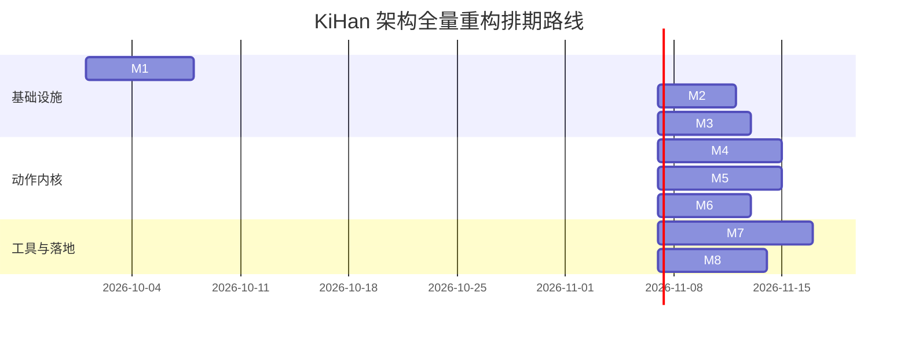

# KiHan 格斗框架与底层架构全量重构规划方案 (REFACTOR_PLAN)

> **文档定位**：本项目（KiHan）从早期“硬编码状态机 + 纯 2D 平铺层级 + 浮点物理”向工业级“**定点数确定性逻辑内核 + ACT 数据驱动动作系统 + 真实 3D 深度渲染 + 统一资源管线 + 可视化动作编辑器**”全量重构的技术路线与执行规范。供方案审核与迭代编辑。

---

## 目录
- [一、 重构核心目标与设计原则](#一-重构核心目标与设计原则)
- [二、 架构演进：现状 vs 目标架构](#二-架构演进现状-vs-目标架构)
- [三、 核心子系统详细改造方案](#三-核心子系统详细改造方案)
  - [1. 定点数数学库与确定性动力学](#1-定点数数学库与确定性动力学)
  - [2. 真实 3D 纵深渲染与 2D/3D 混合深度穿插](#2-真实-3d-纵深渲染与-2d3d-混合深度穿插)
  - [3. 统一资源管理与分级对象池体系](#3-统一资源管理与分级对象池体系)
  - [4. ACT 数据驱动动作框架与确定性输入流](#4-act-数据驱动动作框架与确定性输入流)
  - [5. 5 维打击反馈、受击状态与霸体](#5-5-维打击反馈受击状态与霸体)
  - [6. 技能资源系统、查克拉与分身生成体系](#6-技能资源系统查克拉与分身生成体系)
  - [7. 动画表现驱动解耦与骨骼挂点系统](#7-动画表现驱动解耦与骨骼挂点系统)
  - [8. ACT 可视化动作时间轴编辑器](#8-act-可视化动作时间轴编辑器)
- [四、 重构里程碑与任务清单 (Milestones 1 ~ 8)](#四-重构里程碑与任务清单-milestones-1--8)
- [五、 鸣人 (Naruto) 动作规格设计表 (参照 naruto.md)](#五-鸣人-naruto-动作规格设计表-参照-narutomd)
- [六、 质量验收、Desync 自动化校验与风险策略](#六-质量验收desync-自动化校验与风险策略)

---

## 一、 重构核心目标与设计原则

1. **绝对的帧同步确定性 (Deterministic Lockstep)**：
   - 逻辑层与表现层 100% 隔离。逻辑层严禁出现 `Time.deltaTime`、`UnityEngine.Random`、IEEE 754 浮点数、Unity 原生 Collider / Rigidbody。
   - 所有物理位移、判定盒、技能 CD、动作流转完全基于定点数（`FP`）与固定逻辑帧（Fixed Tick）。
2. **数据驱动动作系统 (Data-Driven ACT Engine)**：
   - 废弃针对每个角色手写 C# State 类的传统状态机模式。
   - 动作、连招打断（`CancelTag` / `BeCancelledTag`）、搓招指令（`ActionCommand`）、攻击盒（`AttackInfo`）、受击动作改变（`ActionChangeInfo`）全部由配置文件驱动。
3. **彻底解决 2.5D 与 3D 素材穿插问题**：
   - 摒弃脆弱的手算 `sortingOrder` 机制，直接将纵深映射为 Unity 世界坐标的真实 Z 轴，依托 GPU 硬件级深度缓冲（Z-Buffer）实现 2D 贴花、3D 粒子、3D 角色网格的自然遮挡。
4. **战斗中“0 IO，0 动态分配 (Zero-Alloc & Zero-IO)”**：
   - 战斗局内严禁动态调用 `Resources.Load` 或无保护的 `Instantiate`。
   - 建立统一抽象的 `IAssetProvider` 与分级生命周期对象池，对局前完成预热，对局中仅做池内复用。
5. **所见即所得的编辑器工具链**：
   - 提供可视化时间轴编辑器（Action Timeline Editor），打通动画切片、判定盒绘制、取消窗口配置与事件标记的全流程。

---

## 二、 架构演进：现状 vs 目标架构

### 1. 架构对比总览

```
【现状 As-Is】
客户端输入 -> InputFrame
               ↓
        LSRoom.Tick() (固定帧)
               ↓
    CharacterEntity (浮点 Vector2 + height 混合)
               ↓
   硬编码状态机 StateMachine (CommonStateIdle, NarutoStateAttack...)
               ↓ (直接耦合美术路径)
   Resources.Load<AnimationFrameData>()
               ↓
   PlayerView -> 手动计算 sortingOrder = (2000 - y*100)*2
               (导致 3D 粒子特效、网格层级错乱穿插)

────────────────────────────────────────────────────────────────────────

【目标 To-Be】
网络输入流 -> InputFrame (6 Bytes)
                    ↓
       DeterministicCommandSource (离散帧按键队列与搓招识别)
                    ↓
       ActionController (ACT 动作控制器: CancelTag 决策 / 逻辑 Tick 推进)
                    │
  ┌─────────────────┼──────────────────────────────┐
  │                 │                              │
[定点数动力学]     [5维受击与霸体]               [技能与生成工厂]
ForceMove / 重力   平推/击飞/吸附/抓取/扫地       SimpleEntity vs Actor 分身
  │                 │                              │
  └─────────────────┼──────────────────────────────┘
                    ↓
         生成逻辑快照 Snapshot 与 ActionEvent 队列 (纯数据)
══════════════════════════════════════════════════════════════════ [逻辑/表现严格分水岭]
                    ↓ (单向通知)
         ActorView 表现层 (逻辑帧快照插值，只读 CharacterObj)
                    ├─ 坐标映射: BattleViewSpace (纵深 -> 真实 Z 深度，屏幕布局与原 2D 一致)
                    ├─ 深度测试: Alpha-Test ZWrite Shader (透明队列 + 写深度)
                    ├─ 精灵帧: 直接读取 FrameAnimator 当前切片步 (素材帧率 = 逻辑帧率)
                    └─ 资源管理: AssetManager + EnhancedObjectPool (全池化)
```

---

## 三、 核心子系统详细改造方案

### 1. 定点数数学库与确定性动力学
- **定点数方案选择**：
  - 引入 64 位定点数（Q32.32 精度）基础库 `FP`，整数部分 32 位，小数部分 32 位，精度达 $2.32 \times 10^{-10}$，满足跨平台绝对一致性。
  - 数据结构：`FP`、`FPVector2`、`FPVector3`、`FPMath`（含查表法的高性能确定性 `Sin`, `Cos`, `Atan2`, `Sqrt`）。
- **确定性运动体 (`Game/Physics/MotionBody.cs`)**：`Position` (`FPVector3`：x 横向、y 纵深、z 离地高度)、`VelocityZ`、`GravityScale`；水平面走曲线位移，竖直只走速度模型。旧 `LogicEntity` 已随 M3 删除。
- **表现层转换器规范**：
  - 逻辑层禁止引用 `UnityEngine.Vector3`，表现层仅在渲染更新时单向读取定点数并经 `BattleViewSpace` 映射。

### 2. 真实 3D 纵深渲染与 2D/3D 混合深度穿插 (M3 已完成)
- **唯一映射入口 `View/Render/BattleViewSpace.cs`**：不旋转的正交相机 (沿 +Z 观察)，角色、特效、地图等 2D 素材同样不旋转，正立显示。
  $$\text{World}(x, y, z) = (x,\; k\,y + z,\; y),\quad k = \texttt{DepthToScreenY}\ (\text{原版实测 } 0.368，与脚下阴影圆盘纵向压缩共用)$$
  - 逻辑坐标：$x$ 横向、$y$ 纵深、$z$ 离地高度 (与 `MotionBody` 一致)。
  - 屏幕横坐标 $= x$，屏幕纵坐标 $= k\,y + z$：纵深按比例 $k$ 压缩到屏幕纵向，高度 1:1；地图美术无需改动。
  - 世界 Z $= y$，只取决于纵深：跳跃不改变前后关系；同一像素上前后由深度缓冲裁决，角色之间不再计算 sortingOrder。
  - 逻辑层不感知相机：`FPVector2.ToRenderWorldPos` 已删除，表现层统一调用 `BattleViewSpace.ToWorld / GroundToWorld`。
- **渲染顺序与 Shader**：
  - 角色材质 `Resources/Render/SpriteZWriteAlphaTest.mat` (`KiHan/Render/SpriteZWriteAlphaTest`)：`ZWrite On` + `clip(alpha - 0.1)`，渲染队列为 **Transparent**。与背景、阴影、特效同队列按 sortingOrder + 与相机的距离排序，边缘半透明像素混合到已绘制的背景上，避免黑边。
  - 地图为 2D 背景板，放在所有角色之后 (世界 Z = `BackdropDistance`)，sortingOrder 整体偏移 `BackdropSortingOffset` 保证最先绘制 (不写深度的特效不会被背景覆盖)。
  - 额外图层 (`EffectLayerInfo.OrderOffset`) 换算为朝相机 (-Z) 的微小深度偏移。
  - 打击火花、伤害跳字朝相机 (-Z) 前移 `ForegroundOffset`，位于参与命中的双方之前。
- **角色视图 `ActorView` (代码构建，无预制体，全部节点不旋转)**：`ActorView(地面锚点 (x, y, y)) / { 脚下阴影, Body(本地 Y = 高度 z) / Sprite / ExtraLayer_n }`。
  - 位置在相邻两个逻辑帧快照之间插值 (滞后一帧，任意渲染帧率平滑)；精灵帧与朝向直接读取逻辑当前状态。
  - 脚下阴影挂在地面锚点节点，不随跳跃升高，+Z 略微后移保证在本角色身后。
  - 跟随型特效挂到 `ActorView.Body`；Gizmos 按逻辑判定盒 (`LogicBox.ToWorld`) 绘制。
- **逻辑 -> 表现事件**：`BattleManager.OnBattleTick` 驱动 `BattleWorld.Tick` 后调用 `SceneManager.OnLogicTick`：推进视图快照，并把本帧 `HitEvents` 转为火花 / 伤害跳字 / 震屏 (`HitEvents` 每帧清空，必须逐帧消费)。

### 3. 统一资源管理与分级对象池体系
- **资源路径解耦与提供器模式 (`IAssetProvider`)**：
  ```csharp
  public interface IAssetProvider
  {
      T LoadAsset<T>(string address) where T : UnityEngine.Object;
      UniTask<T> LoadAssetAsync<T>(string address) where T : UnityEngine.Object;
      void ReleaseAsset(string address);
  }
  ```
  - 初期实现：`ResourcesAssetProvider`（平滑兼容本地工程）。
  - 远期实现：`AddressablesAssetProvider`（无需修改上层业务即可开启热更分包）。
- **分级生命周期对象池 (`EnhancedObjectPool`)**：
  - 契约接口：`IPoolable`（`OnSpawn()` 初始化粒子状态；`OnRecycle()` 还原速度、停止音频）。
  - 对象池分类隔离：
    1. **特效池 (`FXPool`)**：打击火花（`Spark1`~`Spark5`）、刀光贴花、3D 粒子，绑定自动回收组件。
    2. **实体表现池 (`EntityViewPool`)**：火球、苦无等简单投射物预制体；影分身预制体。
    3. **UI 元素池 (`UIPool`)**：伤害跳字文本（`DamageTextNode`）、血条飘字。
- **局内加载管线**：
  - 选人结算完毕进入对局 Loading：解析双方角色 Action 配置表引用的全部资源，预先实例化灌入对象池（Prewarm），战斗期间保持 0 磁盘 IO 与 0 GC 发生。

### 4. ACT 数据驱动动作框架与确定性输入流
- **动作数据结构 (`ActionInfo`) 字段规范**：
  - `id` (string)：动作唯一标识符。
  - `animKey` (string)：表现层关联动画名。
  - `catalog` (string)：动作类别（如 `Hurt_Ground`, `Hurt_Air`, `Attack`）。
  - `durationTicks` (int)：动作持续的固定逻辑帧数。
  - `autoNextActionId` (string)：自然播放结束后的流向动作。
  - `keepPlayingAnim` (bool)：循环或打断自身时是否维持当前播放进度。
  - `autoTerminate` (bool)：未持续接收到输入时是否提前终止。
  - `cancelTag` (CancelTag[])：该动作拥有的打断标签。
  - `beCancelledTag` (BeCancelledTag[])：可被其他打断标签中断的逻辑帧窗口及优先级。
  - `inputAcceptance` (MoveInputAcceptance[])：各帧段移动摇杆速度继承比率。
  - `attacks` (AttackInfo[])：包含的攻击段落数值与 5 维反馈。
- **确定性指令缓冲源 (`IActionCommandSource`)**：
  - 帧同步收到的 `InputFrame` 经由此层转化为离散的 `KeyMap` 序列（Punch, Kick, Skill1, Skill2, 方向 1~9 宫格）。
  - 维护固定容量的滑动逻辑帧队列，支持按键有效帧窗口校验（`validInTicks`）与经典格斗搓招识别。
- **位移计算模型 (`ForceMove`)**：
  - 动作位移分为常规移动（`NatureMove` = 摇杆输入 $\times$ `MoveInputAcceptance` + `RootMotion`）与强制外力位移（`ForceMove`）。
  - `rootMotion` 为分段列表，每段带 `frameRange`：水平 `moveX/moveY` 按 `tweenMethod` (与 ForceMove 共用缓动表) 分配到区间内，多段同帧相加；竖直 `velocityZ` 在区间起始帧设置竖直速度 (起跳/二段跳)，`accelerationZ` 在区间内附加加速度。动作按状态切分 (循环、输入入口、落地转换、受击)，同一段连续动画上的位移变化用多段描述，不拆动作。
  - 处于受击推移、技能突进时，`ForceMove` 接管角色位移，采用确定性定点数插值曲线（Linear, QuadOut 等）。

### 5. 5 维打击反馈、受击状态与霸体
> 范围调整 (2026-10-10)：**停帧 (全局 Freeze) 与保护机制 (浮空黄保/红保、扫地保护、站立保护) 移出本计划**；受击后不改变朝向；攻击种类 (普通/技能/抓取/毒伤) 细分与霸体矩阵后续再做；撞墙不反弹；闪现等动作后续再做。

- **物理约定**：逻辑坐标 `x` 横向、`y` 纵深、`z` 高度；水平面走曲线位移 (RootMotion / ForceMove / 吸附)，竖直方向只走速度模型 (起跳/击飞速度 + 附加加速度 + 重力，匀加速精确积分)；墙体仅为地图边界墙；角色之间不碰撞。
- **受击状态 (`HurtState`)**：
  - **僵直 (Stun)**：地面受击，不能主动行动，受击动作循环播放，`hitStun` 秒到期后回到受击动作的 `autoNextActionId`。
  - **击飞 (Launch)**：空中受击或被击飞，不能主动行动，按速度模型下落。地面被击飞 `hurt_toair → hurt_inair → hurt_fall`，空中受击直接 `hurt_inair → hurt_fall`，`hurt_fall` 循环到触地。触地时弹起速度 = 落地速度 × `bounceRestitution`，不低于 `minBounceVelocity` 则弹起 (重播 `hurt_inair`，无伤害，保持击飞)，否则倒地。
  - **被抓取 (Grabbed)**：位置逐帧锁定在抓取者的帧锚点上，不受重力与外力影响。
  - **倒地 (Lying)**：播放 `lie`，播完即起身 (倒地时长 = lie 动画长度)；只有 `canHitLying` 的攻击能命中，带击飞速度时重新浮空。
  - **起身 (Standup)**：播放 `standup`，期间无敌 (不产生任何命中)，播完回到默认动作并追加 `standupInvincibleSec` 秒无敌。
  - 受击流程由框架驱动，受击动作只提供动画，`autoNextActionId` 不参与；命中切换优先级 100 > 触地结果 95 > 动画播完推进 90。
- **通用受击动作 (`HurtActionIds`)**：所有角色共用同一套受击流程，以下动作 id 固定且必须全部配置 (加载时检查缺失)：`hurt_1` `hurt_2` `hurt_toair` `hurt_inair` `hurt_fall` `lie` `standup`。攻击未配置 `targetActionChange` / `launchActionChange` 时，僵直默认 `hurt_1`、抓取默认 `hurt_2`、地面击飞默认 `hurt_toair`、空中受击默认 `hurt_inair`。最小配置见 `action_template.json`。
- **角色物理参数** (CharacterObj，带默认值)：`gravity`、`bounceRestitution` (0.5)、`minBounceVelocity` (3)、`standupInvincibleSec` (0.5)。
- **姿态隐性控制 (不配置 `posture`)**：
  - 进入条件由 `cancelTag` / `beCancelledTag` 的取消关系决定 (如空中攻击只挂在跳跃动作的取消窗口上)。
  - 配置了 `onLand` 且自身不起跳的动作视为空中动作，在地面上视同落地触发 `onLand`。
  - 倒地、击飞落地等状态由上面的固定受击动作 id 决定。
- **5 维打击物理**：
  1. **平推 (Push)**：`pushPower` 水平 `ForceMove` (按秒配置，与动作帧无关)，按攻击者朝向转为世界方向。
  2. **击飞 (Launch)**：`launchVelocity` 设置竖直初速度；目标已在空中时进入击飞，`airLaunchVelocity` 用于空中追击上挑。
  3. **吸附 (Suction)**：命中后在 `inSec` 秒内以 `speed` 把目标水平拉向攻击者本地核心点 (随攻击者移动，不越过核心点)。
  4. **抓取 (Grab)**：锚点即抓取。`grab.anchor` 指定帧库 `EffectAnchors` 中的锚点名 (默认 `grab`，整数像素，x 随朝向镜像、y 为高度)，抓取者当前处理的动画帧上存在该锚点即维持抓取并逐帧跟随 (可跨动作)，锚点消失即释放 (主动松手 / 动作播完 / 被打断)，目标按 `releaseActionChange` 转换，在空中则击飞下落。被抓期间受到的任何命中 (抓取者的多段攻击、第三方攻击) 只结算伤害，保持原抓取状态，也不会被其他抓取覆盖；投掷做法是让锚点在第 N 帧消失、同一帧开启投掷攻击盒 (释放先于命中检测)，投掷命中按正常受击结算。加载时校验抓取段开启区间内是否画有锚点。
  5. **扫地 (OTG)**：`canHitLying` 的攻击可命中倒地目标；带击飞速度时重新挑起，否则保持倒地只结算伤害。
- **霸体等级裁决 (`ArmorLevel`)**：
  - 等级顺序：`None(0) < Skill(1) < Super(2) < KingKong(3) < Invincible(4)`，由动作 `armorPhase` 按动画帧区间配置。
  - 攻击 `armorBreak` >= 受击者当前霸体等级时完整受击，否则只结算伤害、不打断当前动作；`Invincible` 不产生命中。
- **结算流程 (`BattleWorld` + `HitResolver`)**：输入 → 动作推进 (收集预约) → 物理 → 抓取/吸附 → 命中收集 → 统一结算 (扣血、霸体裁决、受击反应) → 动作预约按优先级当帧裁决。

### 6. 技能资源系统、查克拉与分身生成体系
- **技能资源控制器 (`SkillController`)**：
  - 管理技能 CD（逻辑帧单位倒计时）、技能段落流转（多段技能分支与超时还原）。
  - 查克拉（奥义点）体系：最大 4 颗奥义点，命中敌人增加奥义点，释放奥义消耗 4 点，释放替身术消耗 1 点并触发无敌替身木头。
- **分身与投射物生成规范 (严格遵从 `EntityController.md`)**：
  - 生成类型严格划分为两类：
    - `SpawnObjectType.SimpleEntity`：火球、手里剑、风魔手里剑、地刺陷阱。使用轻量级生命周期，不挂载动作状态机。
    - `SpawnObjectType.Actor`：鸣人影分身、木叶丸、佐助雷分身、通灵召唤兽。复用 `CharacterEntity` + `ActionController`，由 `CloneBrain` 注入输入指令，具备完整的动作打断与受击能力。
  - 分身生命周期组件 (`SpawnedActorLifecycle`)：追踪主人归属、存活逻辑帧倒计时、消失动作调用与对象池回收。

### 7. 动画表现驱动解耦与骨骼挂点系统
- **逻辑与渲染分离 (M3 已完成)**：`FrameAnimator` 为纯逻辑整数帧播放器 (推进帧、判定盒、锚点)，不再持有 SpriteRenderer；`ActorView` 读取 `CurrentAnimData` / `CurrentStepIndex` 与 `CharacterObj.FacingLeft` 绘制。
- **3D 角色驱动 (未开始)**：`Animator3DDriver` 根据 ActionId 执行 `CrossFadeInFixedTime`，届时与 `ActorView` 的 2D 精灵绘制并列。
- **挂点 (未开始)**：帧库 `EffectAnchors` 已提供逐帧整数锚点 (逻辑抓取在用)；表现层挂点需按当前帧锚点定位特效，当前跟随型特效统一挂在 `ActorView.Body` 上加像素偏移。

### 8. ACT 可视化动作时间轴编辑器 (Action Timeline Editor)
- **编辑器界面核心布局**：
  - **多轨道时间轴 (Multi-Track Timeline)**：
    - **帧序列轨 (Frame Track)**：直观拖拽帧长度（Ticks）。
    - **攻击盒轨 (HitBox Track)**：可视化色块展示攻击阶段，点击配置伤害与 5 维参数。
    - **受击盒轨 (HurtBox Track)**：展示受击判定盒激活区间。
    - **取消窗轨 (Cancel Window Track)**：高亮展示当前动作允许被 Cancel 的逻辑帧范围与 Tag。
    - **事件轨 (Event Track)**：在指定帧打点标记音效、火花特效、震屏与生成物。
    - **位移轨 (RootMotion Track)**：绘制定点数位移曲线。
- **Scene 视口交互**：
  - 鼠标直接在 Scene 视口中拖拽调整判定盒尺寸与相对偏移。
  - 支持逐逻辑帧前进/后退预览、连招打断模拟预览。
- **一键导出验证**：
  - 自动运行静态校验（死循环检测、无效打断标签预警），一键生成运行时的 JSON/二进制动作资产。

---

## 四、 重构里程碑与任务清单 (Milestones 1 ~ 8)



| 里程碑 | 核心产出文件 | 重点改造内容 | 验收标准 |
| :--- | :--- | :--- | :--- |
| **M1: 定点数数学库与物理改造** | `Math/FP.cs`<br>`Math/FPVector2.cs`<br>`Physics/MotionBody.cs`<br>`LogicCommon.cs` | 1. 建立纯定点数数学运算库<br>2. 实体坐标、速度、高度、重力定点数化<br>3. 判定盒 `LogicBox` 切换为定点数碰撞 | 编写纯单元测试：跨平台运行 10000 次复杂物理模拟运算，哈希值绝对一致。 |
| **M2: 资源管理与对象池** | `Managers/Asset/IAssetProvider.cs`<br>`Managers/Asset/ObjectPoolManager.cs`<br>`View/Component/AutoRecycleFX.cs` | 1. 抽象资源提供器接口<br>2. 实现按类型隔离的分级对象池<br>3. 改造战斗前加载预热流程 | 连续对战 5 分钟，战斗运行时无任何 `Resources.Load` 与新实例分配产生的 GC Spike。 |
| **M3: 3D 纵深渲染与穿插 (已完成)** | `View/Render/BattleViewSpace.cs`<br>`View/Render/ActorView.cs`<br>`View/Render/Shaders/SpriteZWriteAlphaTest.shader`<br>`Game/Core/BattleManager.cs`<br>`Game/Core/CharacterFactory.cs`<br>`Game/SceneManager.cs` | 1. `BattleViewSpace` 统一映射 `World = (x, k·y + z, y)` (`DepthToScreenY`)：纵深为真实 Z 深度并按比例投到屏幕纵向<br>2. 相机与素材均不旋转 (正交，沿 +Z 观察)，地图为放在最远处的背景板<br>3. 角色材质 Alpha-Test ZWrite (透明队列)<br>4. `ActorView` 只读绑定 `CharacterObj`，`BattleManager` 驱动 `BattleWorld`，`HitEvents` 转火花/跳字/震屏<br>5. 删除旧表现链路 `LogicEntity` / `EntityView` / `EffectNode` / `HitData` | 3D 粒子特效在角色身前身后穿梭时产生自然的前后遮挡，彻底移除手算 sortingOrder。 |
| **M4: ACT 动作核心与输入** | `Characters/Action/ActionInfo.cs`<br>`ActionController.cs`<br>`DeterministicCommandSource.cs`<br>`ForceMove.cs` | 1. 动作配置数据结构定点数化<br>2. 逻辑帧驱动的 `ActionController`<br>3. 搓招按键队列与打断窗口决策 | 动作可由 JSON 表驱动，普攻 1~4 段可通过 `CancelTag` 流畅打断与自然衔接。 |
| **M5: 5 维打击与受击状态** | `Game/Core/BattleWorld.cs`<br>`Game/Physics/MotionBody.cs`<br>`Character/Fight/HitResolver.cs`<br>`Character/Fight/CombatTypes.cs`<br>`Character/Fight/HurtState.cs`<br>`Character/Fight/HiRecord.cs` | 1. 平推、击飞、吸附、抓取、扫地 5 种受击物理<br>2. 僵直/击飞/被抓/倒地受击状态<br>3. 霸体等级判定 | 僵直期间不能行动且循环受击动画；击飞落地转倒地；霸体只扣血不打断；抓取逐帧跟随帧锚点、锚点消失即释放；整条命中链路 0 GC。（停帧与保护机制已移出计划） |
| **M6: 技能/查克拉/分身系统** | `Characters/Combat/SkillController.cs`<br>`SpawnFactory.cs`<br>`SpawnedActorLifecycle.cs`<br>`CloneBrain.cs` | 1. 多段技能 CD 与查克拉奥义点管理<br>2. 区分 SimpleEntity 与 Actor 分身生成<br>3. 分身通过 `CloneBrain` 驱动动作控制器 | 鸣人可释放多段技能；分身生成后独立执行攻击动作并按存活时限回收。 |
| **M7: 可视化时间轴编辑器** | `Editor/ActionTimeline/ActionEditorWindow.cs`<br>`TimelineTracks.cs`<br>`BoxGizmoDrawer.cs` | 1. 实现时间轴多轨道可视化（帧/盒/打断/事件/位移）<br>2. Scene 视口鼠标直观拖拽编辑判定盒<br>3. 动作数据完整性校验与导出 | 策划或开发者无需手写 JSON，在编辑器内 10 分钟内完成一个全新动作的完整配表。 |
| **M8: 鸣人迁移与联机验收** | `ArtAssets/Characters/90001_Naruto/`<br>`naruto_actions.json`<br>`NarutoEntity.cs` | 1. 迁移鸣人全部动作至新框架<br>2. 彻底移除旧版状态机代码<br>3. 双端联机帧同步对战压力测试 | 双端 KCP 联机对战，连续执行 1000 帧复杂连招对抗，状态校验和一致，0 脱同步。 |

---

## 五、 鸣人 (Naruto) 动作规格设计表 (参照 naruto.md)

以下为重构后鸣人核心动作集合规范，直接映射为 `naruto_actions.json`：

| 动作 ID (`id`) | 动作类型 (`catalog`) | 自身打断标签 (`cancelTag`) | 允许被取消窗口 (`beCancelledTag`) | 自然流向 (`autoNextActionId`) | 核心特性 / 事件说明 |
| :--- | :--- | :--- | :--- | :--- | :--- |
| **`idle`** | `Base` | - | `move`, `attack1`, `skill1`, `skill2` | `idle` | 呼吸待机，允许全招式打断，`keepPlayingAnim=true` |
| **`move`** | `Base` | `move` | `move`, `attack1`, `skill1`, `skill2` | `idle` | 跑步，继承摇杆移动速度 (`inputAcceptance=1.0`) |
| **`attack1`** | `Attack` | `attack1`, `attack` | 50%~100% 允许 `attack2`, `skill1`, `skill2` | `idle` | 平推受击判定，造成轻微地面推移 |
| **`attack2`** | `Attack` | `attack2`, `attack` | 45%~100% 允许 `attack3`, `skill1`, `skill2` | `idle` | 平推受击判定，带前冲 RootMotion |
| **`attack3`** | `Attack` | `attack3`, `attack` | 50%~100% 允许 `attack4`, `skill1`, `skill2` | `idle` | 击退判定，使目标进入较大受击硬直 |
| **`attack4`** | `Attack` | `attack4`, `attack` | 60%~100% 允许 `skill1`, `skill2` | `idle` | 击飞判定（`launchVelocity`），目标升空进入击飞状态 |
| **`skill1`** | `Skill` | `skill`, `skill1` | 后摇阶段允许 `beCancelTag` | `idle` | 突进分身踢击，霸体等级为 `Skill` |
| **`skill2_1`** | `Skill` | `skill`, `skill2_1` | 允许派生 `skill2_2` | `skill2_2` | 第 10 帧触发事件 `spawnEntity: CharClone` 召唤分身协同 |
| **`skill2_2`** | `Skill` | `skill`, `skill2_2` | 后摇阶段允许取消 | `idle` | 螺旋丸本体突进多段判定，最后一击重度击飞 |
| **`hurt_1`** | `Hurt` | - | 无 | (框架) | 地面轻受击僵直，循环播放，僵直结束回默认动作 |
| **`hurt_2`** | `Hurt` | - | 无 | (框架) | 地面重受击僵直 / 被抓循环 |
| **`hurt_toair`**| `Hurt` | - | 无 | (框架) | 地面被击飞的上升段，播完转 `hurt_inair` |
| **`hurt_inair`**| `Hurt` | - | 无 | (框架) | 空中受击 / 触地弹起，播完转 `hurt_fall` |
| **`hurt_fall`** | `Hurt` | - | 无 | (框架) | 坠落阶段，循环播放直到触地 (弹起或倒地) |
| **`lie`** | `Hurt` | - | 无 | (框架) | 倒地，播完起身，仅受扫地技能影响 |
| **`standup`** | `Hurt`| - | 无 | (框架) | 起身阶段，框架强制无敌，结束后追加无敌 |

---

## 六、 质量验收、Desync 自动化校验与风险策略

### 1. 帧同步脱同步 (Desync) 自动化校验
- **状态哈希校验管线**：
  - 每 30 逻辑帧提取对局上下文计算哈希：
    $$\text{FrameChecksum} = \text{CRC32}\left( \text{FrameId},\, \sum_{\text{entities}} (\text{EntityId} \oplus pos.x \oplus pos.y \oplus height \oplus Blood \oplus ActionId) \right)$$
  - 联机对战中，客户端在上传自己下一帧输入的同时携带最近历史帧的 Checksum，网关/服务器比对不同客户端的 Checksum；一旦分歧立即录制前 60 帧输入包并触发警报，便于精准复现修复。

### 2. 核心技术风险与对应预案
1. **风险：2D Sprite 开启 ZWrite 后产生透明边缘黑边/穿插瑕疵**
   - **预案 (M3 已落实)**：角色 Alpha-Test ZWrite 材质放在透明队列，背景板最先绘制，边缘半透明像素混合到背景上；半透明特效 (羽化火花) 走默认精灵材质，不写深度。
2. **风险：定点数与 Unity 浮点渲染插值抖动**
   - **预案**：表现层使用时间累加插值算法（`Time.deltaTime / LOGIC_TICK_TIME`），保证当逻辑帧率为 30 FPS 时，表现层在 120Hz/144Hz 刷新率下依然丝滑平滑过渡。
3. **风险：重构周期长导致主干功能长期处于不可运行状态**
   - **预案**：采用**双内核并行走**策略。先在独立目录开发定点数与 ACT 内核（Milestone 1~4），通过单机测试场景验证无误后，再接入 `BattleManager` 替换老旧状态机，保障项目主工程始终随时可运行体验。

---
*本方案文档保存在项目根目录下，方便随时查阅与审阅批注。*
